<div align="center">

# ARTEX

Autonomous AI penetration testing system (Go backend + Next.js frontend)


🌐 **Live Demo**: [https://artex-demo.vercel.app/](https://artex-demo.vercel.app/)

</div>

---

## Screenshots

> Explore the full interface in the [Live Demo](https://artex-demo.vercel.app/).

| Dashboard (Overview / Token Usage / Activity Feed) | Task List |
| :---: | :---: |
| 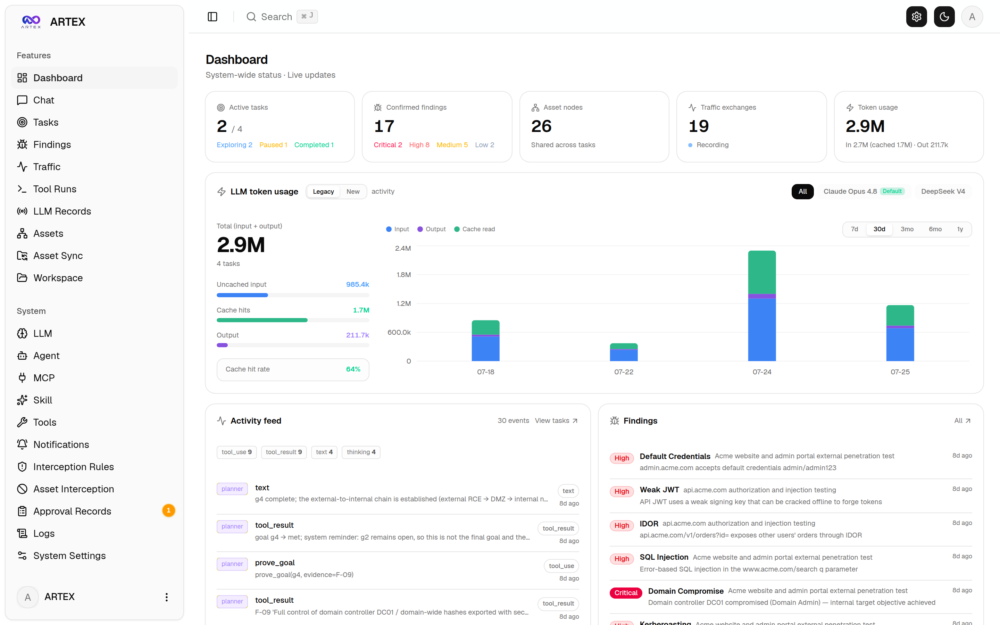 | 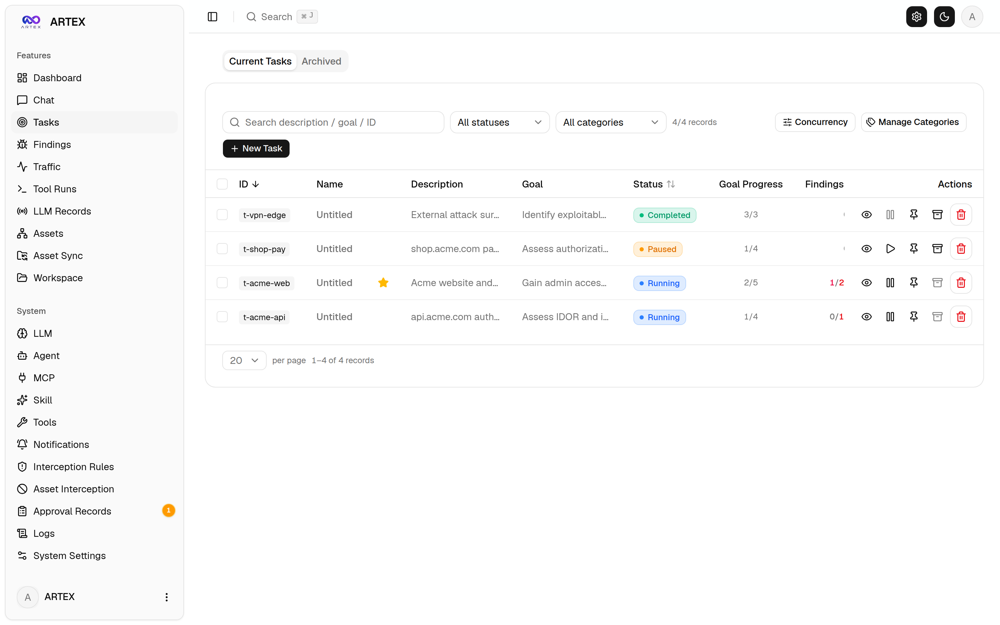 |

| Task Execution (Sessions / Tool Calls) | Exploration Graph |
| :---: | :---: |
| 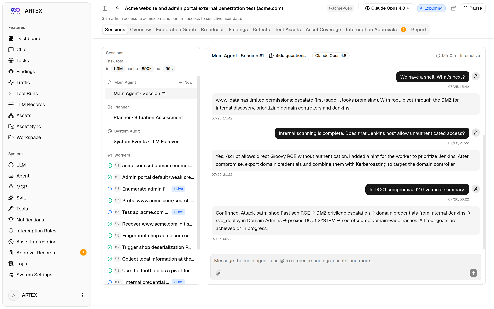 | 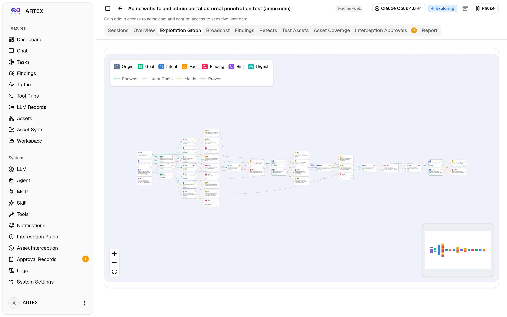 |

| Findings | Assets |
| :---: | :---: |
| 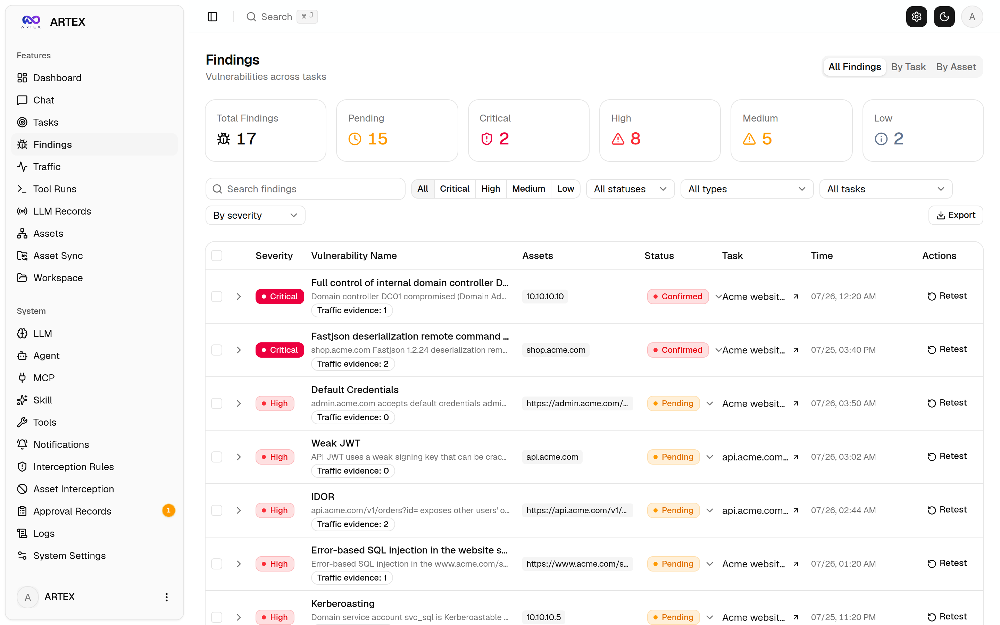 | 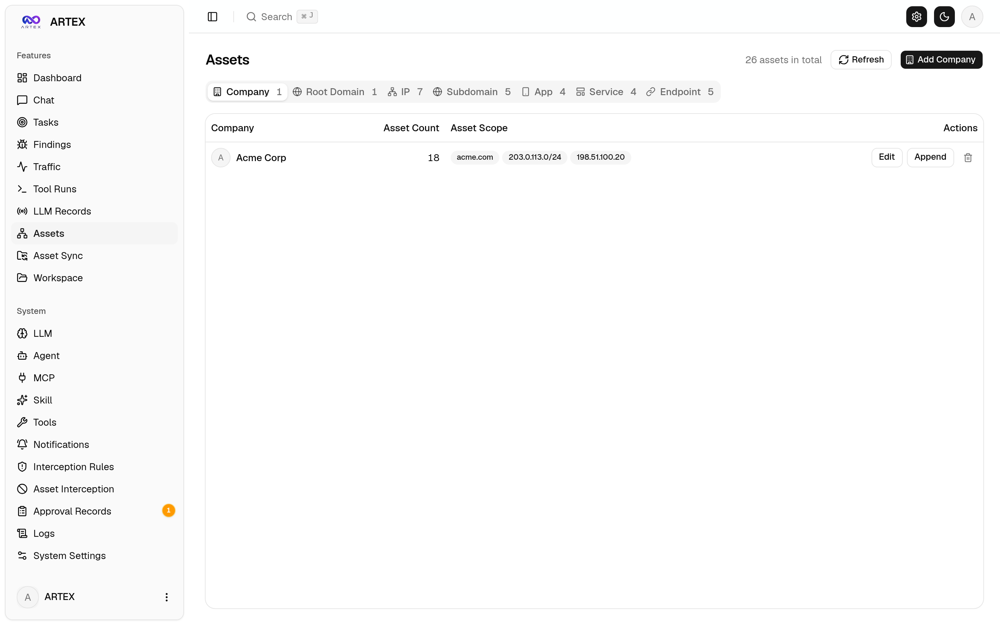 |

| Asset Coverage Graph (Force Layout · Tested Assets Highlighted · Collapsible Nodes) |
| :---: |
| 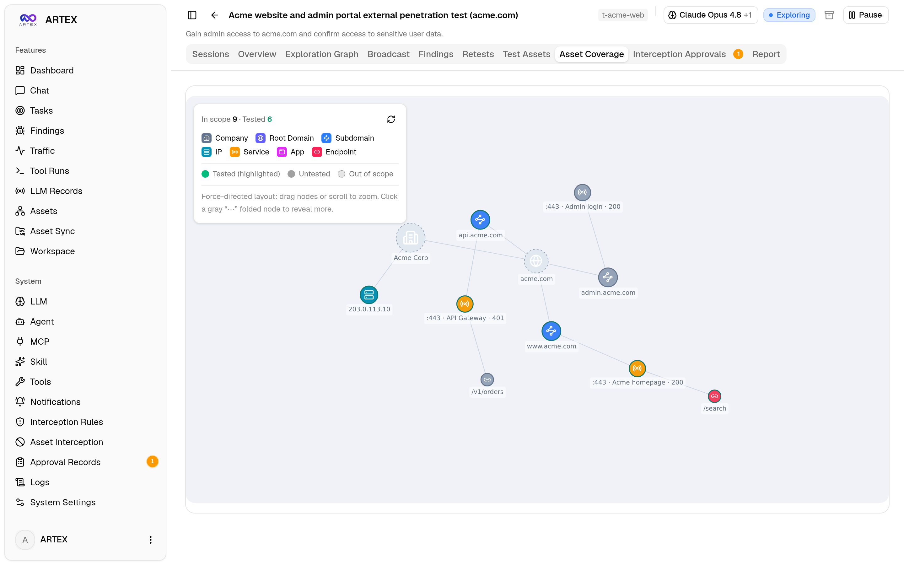 |

| Traffic Recording | Human-in-the-Loop Chat |
| :---: | :---: |
| 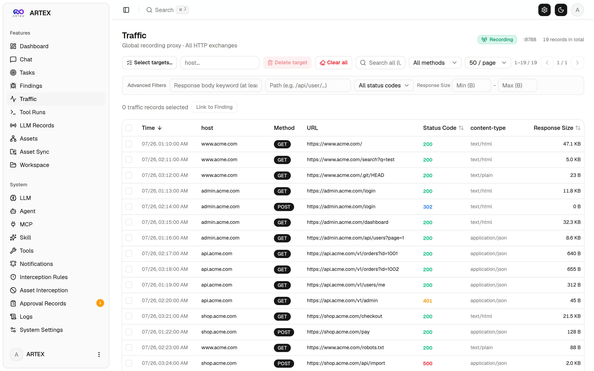 | 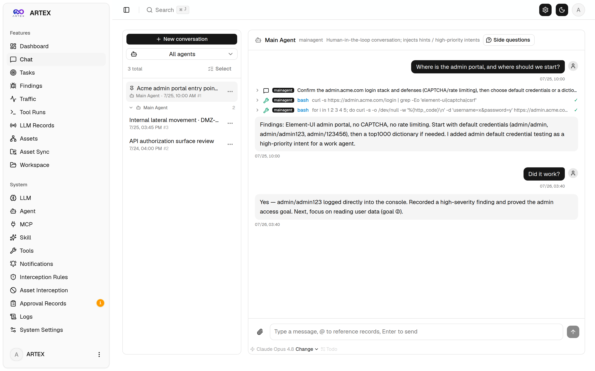 |

| Agent Management | LLM Configuration |
| :---: | :---: |
| 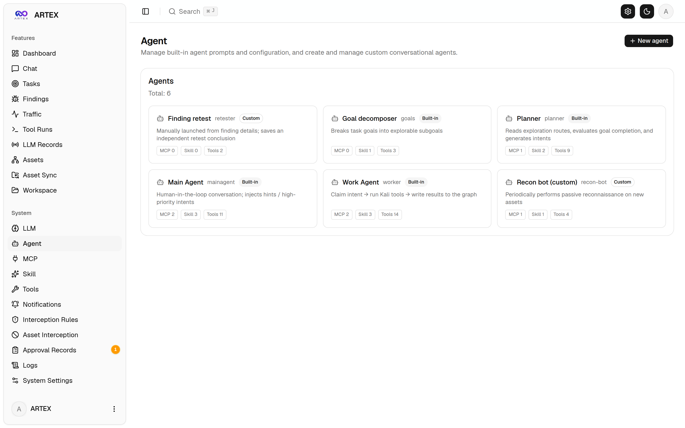 | 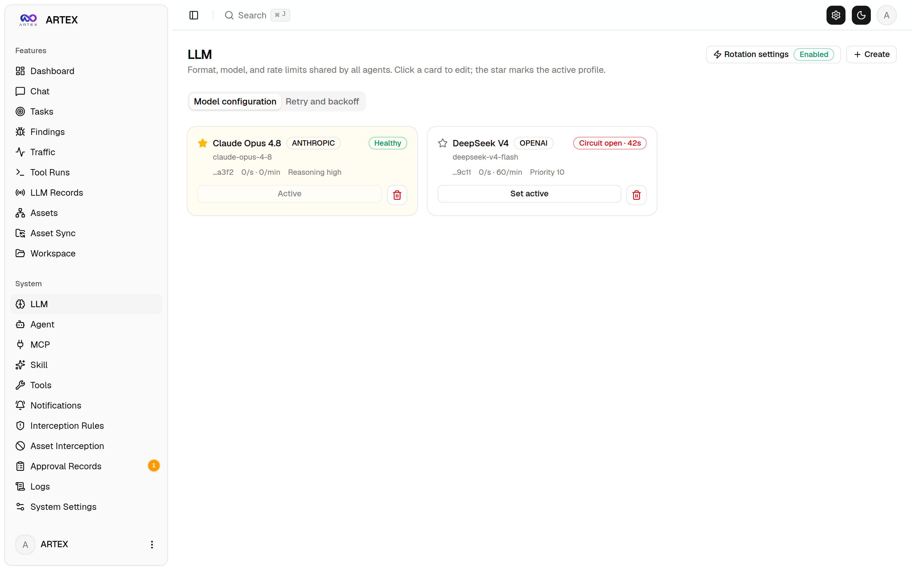 |

| Interception Rules | Backend Logs |
| :---: | :---: |
| 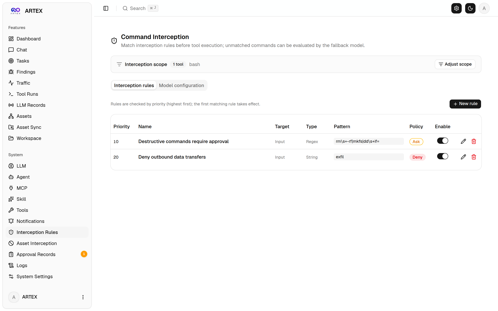 | 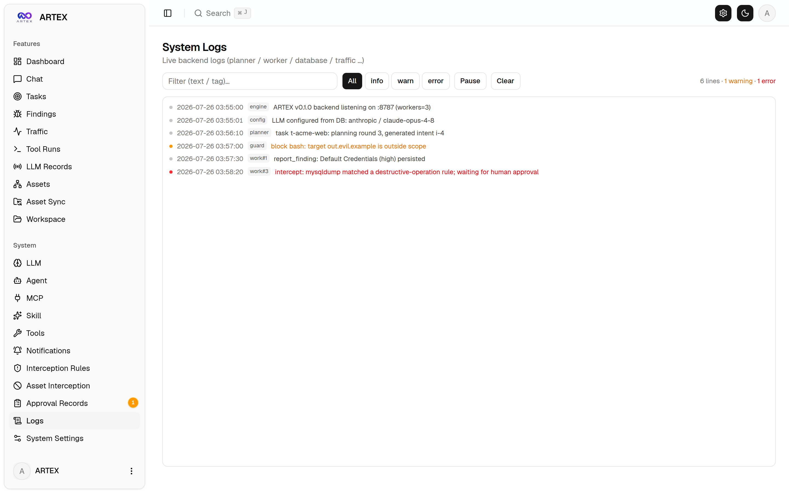 |


---

## Approval Record Details

Global Approval Records, task Interception Approvals, and approval cards in chat can all expand to show details. The layout draws on
[AegisHook's approval details component](https://github.com/RuoJi6/AegisHook/blob/main/web/src/components/CallDetail.vue), using ARTEX's components and theme:


## Asset Synchronization (ScopeSentry)

Synchronize assets directly from [ScopeSentry](https://github.com/Autumn-27/ScopeSentry) to avoid collecting them again:

- Enter the ScopeSentry URL and API Key on the **Asset Synchronization** page to connect the data source.
- Select targets and asset types (domains / subdomains / IPs / ports / sites / endpoints…) by **project** or **task**.
- Import in one click and group assets by company scope, making them available in ARTEX's asset graph for agent exploration.

---

## Installation

> Requires **PostgreSQL**. Exploration requires an **LLM** (`ANTHROPIC_API_KEY` or `OPENAI_API_KEY`, also configurable in the UI).

### Option 1: Installation Script (Recommended)

```bash
git clone https://github.com/Autumn-27/ARTEX.git
cd ARTEX
./install.sh
```

The script detects or installs Docker, then offers **① All Docker** or **② Build and Run Locally**:

- **① All Docker**: Enter a Postgres password (press Enter to generate one) → write `.env` automatically → `docker compose up -d`.
- **② Local Run**: Choose a database (existing or a new Docker instance) → generate `config.json` → build a single binary with embedded UI using `go` → start.

After installation, get the one-time setup token from the server console (`docker compose logs artex` for Docker), then open **http://localhost:8787**. The first visit opens `/setup`, which requires that token before it accepts the administrator password. The HTTP service is loopback-only by default.

### Option 2: Docker Compose (Manual)

```bash
git clone https://github.com/Autumn-27/ARTEX.git
cd ARTEX
cp .env.example .env          # Set POSTGRES_PASSWORD and optionally ANTHROPIC_API_KEY
docker compose up -d          # Pull the autumn27/artex image + postgres
# → http://localhost:8787
```

On first start, run `docker compose logs artex` and copy the `[auth] Setup token` value into `/setup`. For unattended bootstrap, set either `ARTEX_SETUP_TOKEN` or `ARTEX_ADMIN_PASSWORD` in `.env` before the first start. `ARTEX_ADMIN_PASSWORD` is ignored after initialization; remove it from plaintext configuration afterward.

Docker publishes port 8787 on `127.0.0.1` by default. Set `ARTEX_BIND=0.0.0.0` only when an HTTPS reverse proxy or an equivalent trusted network boundary is ready.

The image includes common tools (ripgrep/curl/vim/npm/nmap…); `./skills` and `./data` persist through bind mounts. The JWT root key is stored in the `jwtkeys` volume, outside the browsable workspace. Deploy the updated image and Compose definition together to keep this key stable across container recreation.

For remote MCP, select `http` (Streamable HTTP) or `sse` (legacy SSE) in System Settings.
Legacy SSE services usually establish an event stream with `GET /sse`, then accept JSON-RPC requests at
the returned `/message?sessionId=...` endpoint. Set the URL to `/sse` and enter the header as
`Authorization=Bearer <token>`.

### Option 3: Download a Prebuilt Binary (Releases)

Download the zip for your platform from [Releases](https://github.com/Autumn-27/ARTEX/releases). It contains `artex` + `start.sh` (`start.bat` on Windows) + `skills/` + `config.example.json`:

```bash
cp config.example.json config.json   # Configure the database connection
./start.sh                           # → http://localhost:8787
```

> Start with `start.sh` / `start.bat` instead of running `./artex` directly. This supervisor script uses the exit code to decide whether to restart the program; **the [one-click update](#option-1-one-click-update-recommended) in the UI relies on it to replace the binary**. Running `./artex` directly prevents the program from restarting after an update.
> Run in the background: `nohup ./start.sh >artex.log 2>&1 &`.

### Option 4: Build a Single Binary from Source

```bash
# 1) Export the static frontend
cd web && npm ci && npm run build:static && cd ..
# 2) Copy into the embedded UI directory
cp -r web/out server/webui/dist
# 3) Build (-tags embedui embeds the frontend)
CGO_ENABLED=0 go build -tags embedui -o artex ./cmd/artex
./start.sh
```

### Option 5: Build Cross-Platform Release Archives

`build.sh` builds and embeds the frontend, strips debug information with the Go linker, and packages release files as zip archives. Release mode builds Linux amd64/arm64, macOS amd64/arm64, and Windows amd64 archives by default:

```bash
./build.sh --release
# Output: dist/artex-0.3.3-*.zip
```

UPX self-extracting binaries may be incompatible with some Linux kernels, virtualized environments, or security policies, so UPX is disabled by default. Customize targets with `ARTEX_TARGETS`; if the target environment is compatible, explicitly pass `--upx` to reduce binary size further:

```bash
ARTEX_TARGETS=linux/amd64,windows/amd64 ./build.sh --release
./build.sh --target linux/amd64 --upx
```

---

## Updates and Upgrades

> Upgrades replace the program and retain data: the Postgres volume `pgdata`, the `jwtkeys` volume (`jwt.key`), `./data` (SQLite, etc.), and `./skills` remain intact. **Database migrations run automatically**: `artex` reruns `schema.sql` idempotently at each startup (including `ADD COLUMN` / `CREATE INDEX IF NOT EXISTS`), so restarting applies migrations. Back up `./data`, `./skills`, the database, and the `jwtkeys` volume before upgrading. For native installations, back up `jwt.key` next to the executable instead.

The first upgrade to the hardened authentication format rotates `jwt.key` once and signs out every existing browser. Passwords and application data are preserved. A later binary rollback also requires a fresh login; this prevents pre-upgrade tokens from becoming valid again.

### Option 1: One-Click Update (Recommended)

Check for and install new versions in the **Version & Updates** card on the **System Settings** page (sidebar System Settings → `/system/settings`), without signing in to the server.

Click Update to download the release for the current platform → verify the release's `SHA256SUMS` → smoke-test the new binary with `-h` → stage it as `artex.new` → exit, letting `start.sh` / `start.bat` replace the binary and restart. The page waits for the new version to come online and refreshes automatically.

- **Failures preserve a working program**: Failed verification or smoke tests discard the staged binary and keep the current version running. If the replacement fails to start 3 consecutive times, it rolls back automatically to `artex.old` (the failed binary remains as `artex.failed` for diagnosis).
- **Rollback is available anytime**: The previous version remains as `artex.old`; use Roll Back to Previous Version in the card. Database schema changes are not rolled back.
- **Updates interrupt running tasks**: Updating restarts the program; update while idle.
- **Development builds cannot update**: Updates are disabled for version `dev` or a suffixed `git describe` version to avoid replacing a local development binary with a release.
- **In Docker, only the program is replaced**: The image's playwright / nmap toolchain is not upgraded, and recreating the container with `docker compose up -d` restores the image's bundled version. To upgrade the image as well, use `docker compose pull artex && docker compose up -d artex`.
- If GitHub requires a proxy, configure the **Global Proxy** on the same page; updates use it. Update downloads accept only GitHub domains and require HTTPS.

### Option 2: Update Script

```bash
cd ARTEX
./update.sh
```

The script optionally runs `git pull` to fetch the latest code, then offers **① Docker Update** or **② Local Build Update** (matching `install.sh`):

- **① Docker**: Choose an image tag (press Enter to use `.env`'s `ARTEX_TAG`, default `latest`) → `docker compose pull` → `docker compose up -d` (restarting with the new image applies migrations automatically).
- **② Local**: Rebuild the static frontend → rebuild `./artex` (restart the process to apply the update).

### Option 3: Docker Compose (Manual)

```bash
cd ARTEX
git pull                       # Update compose / scripts (optional)
# Pin a version: set ARTEX_TAG=v0.2.0 in .env; otherwise use latest
docker compose pull artex
docker compose up -d artex     # Restart with the new image → migrate schema automatically
docker image prune -f          # Remove old images (optional)
```

### Option 4: Prebuilt Binary (Releases)

Download the new zip from [Releases](https://github.com/Autumn-27/ARTEX/releases), stop the old process, replace `artex` and `skills/` (keep your `config.json` and `data/`), and restart:

```bash
cp -r <extracted-directory>/skills ./ && cp <extracted-directory>/artex ./
./start.sh
```

### Option 5: Build from Source

```bash
git pull
cd web && npm ci && npm run build:static && cd ..
cp -r web/out server/webui/dist
CGO_ENABLED=0 go build -tags embedui -o artex ./cmd/artex
# Restart ./start.sh
```

---

## Configuration

**Database** (`config.json`, or override with the `ARTEX_PG_DSN` environment variable):

```json
{
  "database": {
    "host": "127.0.0.1", "port": 5432,
    "user": "artex", "password": "yourpass",
    "dbname": "artex", "sslmode": "disable"
  }
}
```

**LLM**: `export ANTHROPIC_API_KEY=sk-...` (or `OPENAI_API_KEY`), also configurable on the UI's LLM Configuration page.
Optional: `ARTEX_LLM_PROVIDER` / `ARTEX_LLM_MODEL` / `ARTEX_LLM_BASE_URL` / `ARTEX_LLM_PROXY`.

**Concurrency**: Configure the number of work agents per task in System Settings (default 3).

**Authentication bootstrap**: An empty installation prints a random setup token once with an `[auth]` prefix. Set `ARTEX_SETUP_TOKEN` to supply that token without logging it, or set `ARTEX_ADMIN_PASSWORD` to initialize the password headlessly. Neither variable overwrites an existing password.

**Browser origins**: Direct same-origin UI requests require no CORS configuration. A TLS-terminating proxy requires its exact public HTTPS origin in `ARTEX_CORS_ORIGINS` (see below). `ARTEX_CORS_ORIGINS` replaces the local development allowlist with comma-separated exact origins; `*` is rejected.

**Common arguments**: `./start.sh -addr 127.0.0.1:8787 -proxy 127.0.0.1:8788` (`-addr` serves the frontend and API; `-proxy` is the traffic-recording proxy). The startup script passes arguments unchanged. Passing `-addr :8787` explicitly exposes the HTTP service on every interface.

### Reverse Proxy Deployment (HTTPS / Only Port 443 Exposed)

The frontend and API/SSE share one backend port (default `127.0.0.1:8787`). The live activity feed uses a **same-origin** URL by default, so **no `NEXT_PUBLIC_SSE_BASE` configuration is needed**. Expose only 443 publicly and keep 8787 on the internal network.

The backend intentionally ignores forwarded headers, so a TLS-terminating proxy must set `ARTEX_CORS_ORIGINS=https://your.domain.com` to its exact public HTTPS origin. For Docker, set this in `.env` and run `docker compose up -d artex`; for native installations, set it in the process environment before restarting.

SSE keeps a connection open and pushes events continuously. The reverse proxy **must disable buffering**, or the browser will connect but receive no events (the activity feed keeps spinning). Nginx example:

> ARTEX does not terminate TLS. Complete administrator setup before changing the bind address, expose only the reverse proxy, and keep the application port private.

```nginx
server {
    listen 443 ssl;
    server_name your.domain.com;
    # ssl_certificate / ssl_certificate_key ...

    location / {
        proxy_pass http://127.0.0.1:8787;
        proxy_set_header Host $host;
        proxy_set_header X-Forwarded-Proto $scheme;

        # SSE essentials: no buffering, long timeout, HTTP/1.1
        proxy_buffering off;
        proxy_cache off;
        proxy_read_timeout 3600s;
        proxy_http_version 1.1;
        proxy_set_header Connection "";
    }
}
```

> Set `NEXT_PUBLIC_SSE_BASE` at **build time** only if SSE must use a different origin from the page (such as a separate subdomain). The variable is embedded in the static bundle by `next build`; setting it at container runtime has no effect.

---


## Development

### Manual Vulnerability Retesting

The Retest tab in task details provides a paginated vulnerability selector, past conclusions and evidence, and manual retesting. Starting a retest keeps the current tab open and shows a spinner with Retesting; confirming a fix also updates the vulnerability status.

Click Retest in a vulnerability row, or Start Retest in the Vulnerability Retest section of its details. Optionally enter a fix version, test conditions, or restrictions; the system creates a separate retest Agent session and keeps the current page open. Flat, task-grouped, and asset views all offer this action. While running, a spinner and Retesting appear; click to open the session if needed. The label returns to Retest when finished. Retesting does not restart the original scan task. Conclusions are Still Reproducible, Fixed, or Inconclusive; each conclusion, its evidence, and its session link are saved in the vulnerability details.

The updated backend seeds an editable Vulnerability Retester (`retester`) Agent on first startup. Configure its prompt, LLM, runtime budget, and tools in Agent Management. It uses its bound LLM, falling back to the globally active configuration if unbound. When a retest session completes successfully with a Fixed conclusion, the system sets the vulnerability's disposition to Fixed. Running, failed, stopped, or other conclusions keep the existing status. Original evidence and reports are always retained. Fixed can also be selected manually in the status dropdown. An ongoing retest for the same vulnerability reuses its existing session; a new retest can start after a stop, failure, or service restart.

In this version, history is available through vulnerability details and sessions; it is not yet included in vulnerability report exports or task archives, and traffic packages are not linked automatically. Demo mode generates clearly labeled mock records without requesting real targets.

### Local Development and Testing

```bash
./dev.sh    # Backend(127.0.0.1:8787) + traffic proxy(127.0.0.1:8788) + frontend next dev(127.0.0.1:5173) → http://127.0.0.1:5173
```

- Backend: `go run ./cmd/artex` (without `-tags embedui`, the frontend is not embedded)
- Frontend: `cd web && npm run dev -- --port 5173 --hostname 127.0.0.1` (`/api` proxies to the backend, with hot reload)
- Tests: `go test ./...`
- Mock preview (no backend): `cd web && NEXT_PUBLIC_MOCK=1 npm run dev`

---

## System Architecture

ARTEX is an **autonomous penetration testing system driven by multiple LLM agents**: a Go monolithic backend (with an embedded Next.js frontend) + PostgreSQL. The [`norma`](https://github.com/Autumn-27/norma) SDK provides agent capabilities (`agentcore` / `tool` / `permission` / `harness` / `memory` / `transcript`). Its core is a **dual-graph architecture**, supported by two mechanisms for autonomy: **execution trace sharing between workers** and **a planner todolist shared across rounds to keep attack chains on track**.

### Architectural Layers

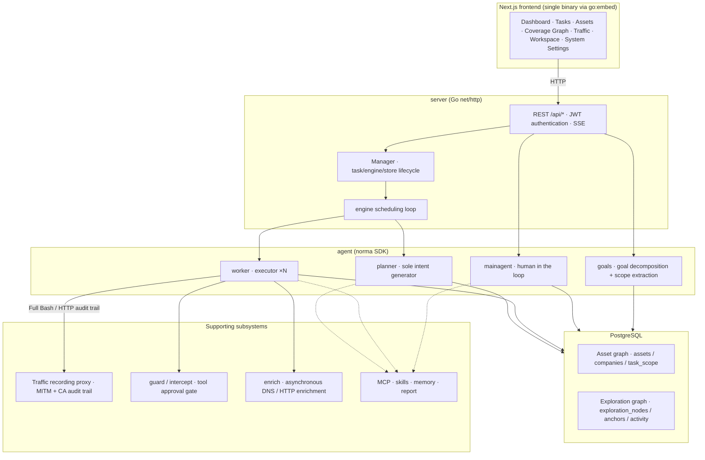

| Layer | Responsibility |
| --- | --- |
| **Frontend** | Next.js static export embedded in a single binary with `go:embed`; task/asset/exploration/coverage visualization and human-in-the-loop chat |
| **server** | `net/http` routing + JWT authentication + SSE; `Manager` owns task, engine, and DB store lifecycles |
| **engine** | One `plannerLoop` + N worker goroutines per task; intent claiming, timeout/pause/drain |
| **agent** | goals / planner / worker / mainagent; `ToolSet` exposes both graphs as LLM tools |
| **db** | Both graphs persisted in Postgres (pgx); schema embedded with `go:embed` creates tables idempotently at each startup |
| **Support** | Recording MITM proxy, approval gate, asynchronous enrichment, MCP/skills/memory/reports |

### Dual-Graph Architecture: Exploration Graph + Asset Graph

The system separates **what the targets are** from **how far testing has progressed** into two independent graphs connected through anchors:

- **Asset Graph (globally shared)**: The common source of truth for assets across tasks. Nodes are `root_domain / subdomain / ip / service / app / endpoint`, owned by companies. The program computes domain → subdomain → service → endpoint relationships and deduplication keys; agents submit only raw information.
- **Exploration Graph (per task)**: A task's reasoning and progress. Nodes are `goal / intent / fact / finding / hint`, connected by edges such as `spawns / derived_from / yields / proves` into a **lineage chain** showing which directions derive from which facts and what they produce.
- **Anchors connect the graphs**: `exploration_anchors(node_id, asset_id)` anchors intents/facts/findings to specific assets. An exploration direction reveals its target assets; an asset reveals which intents tested it and which facts they established in the task. This also supports **asset test coverage** and the **asset coverage graph** (in-scope assets with tested assets highlighted).

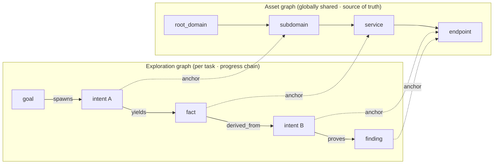

> Responsibilities: The **planner** reads the exploration state, evaluates goals, and adds **intents** to the frontier only for new, uncovered directions. A **worker** claims **one intent**, executes it with real tools, writes new assets/facts/findings to the graphs, and stops. The asset graph holds shared facts; the exploration graph tracks each task's progress.

### Engine and Intent Lifecycle (An Exploration Feedback Loop)

The engine runs an **event-driven** feedback loop: graph changes wake the planner, which creates intents; workers claim and execute them, then write results back, triggering the next round until the goal is proven (`prove_goal`).

```mermaid
sequenceDiagram
  autonumber
  participant EV as Graph change debounce
  participant P as planner
  participant FR as frontier intent queue
  participant W as worker
  participant PX as Recording proxy
  participant DB as Dual graphs + activity

  EV-->>P: Wake
  P->>DB: Read state (graph_overview prefetch + coverage/scope)
  P->>FR: Create 0..N intents (with asset_ids)
  Note over P,FR: Most wakes create 0 intents; finish if no new direction exists
  W->>FR: claimNext claims one intent
  W->>DB: Fetch raw assets for the intent's asset_ids as initial context
  W->>PX: Execute real tools (Kali / Bash / HTTP)
  PX-->>W: Response (full audit trail + CA verification)
  W->>DB: Write fact / asset / finding + per-step activity
  DB-->>EV: Graph change
  EV-->>P: Wake again (feedback loop)
```

### Sharing Execution Traces Between Workers

During a deep exploration, useful observations (an error, a response fragment, a hidden parameter) may appear in a worker's **execution trace** without becoming a formal fact. Workers can **search traces across work runs** to avoid repeating work and build on each other's observations:

- `search_all_worker_traces(q)`: Search **other work execution traces in this task** by keyword (automatically excluding the current intent's steps); matches include `intent_id`.
- `list_worker_traces` / `get_worker_trace(intent_id, step_ids=[…])`: List past work runs, then retrieve the full content of specific steps for detailed information sharing.

Later workers can reuse observations even before a corresponding fact exists in the exploration graph. **Information flows between workers through execution traces**, within the same boundaries: each worker still executes only its claimed intent.

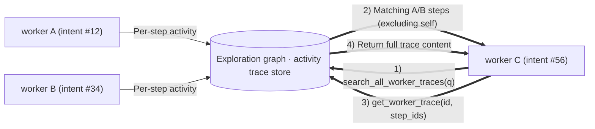

### A Planner Todolist Shared Across Rounds → Reliable Attack Chains

Real attack chains are often **sequences of dependent steps** (for example: find an injection point → obtain credentials → move laterally → escalate privileges). Dispatching all steps in parallel breaks those dependencies. The planner therefore keeps a **per-task planning todolist shared across wakes**:

- The planner wakes on graph changes, but **each wake starts a new session**. Its shared todolist lets it **record a sequential exploit chain once**, then **dispatch intents step by step as dependencies are met** over later rounds.
- Each round dispatches only the next steps whose prerequisites are complete and whose required facts exist, updating the list as progress is made (marking steps satisfied by facts as complete).

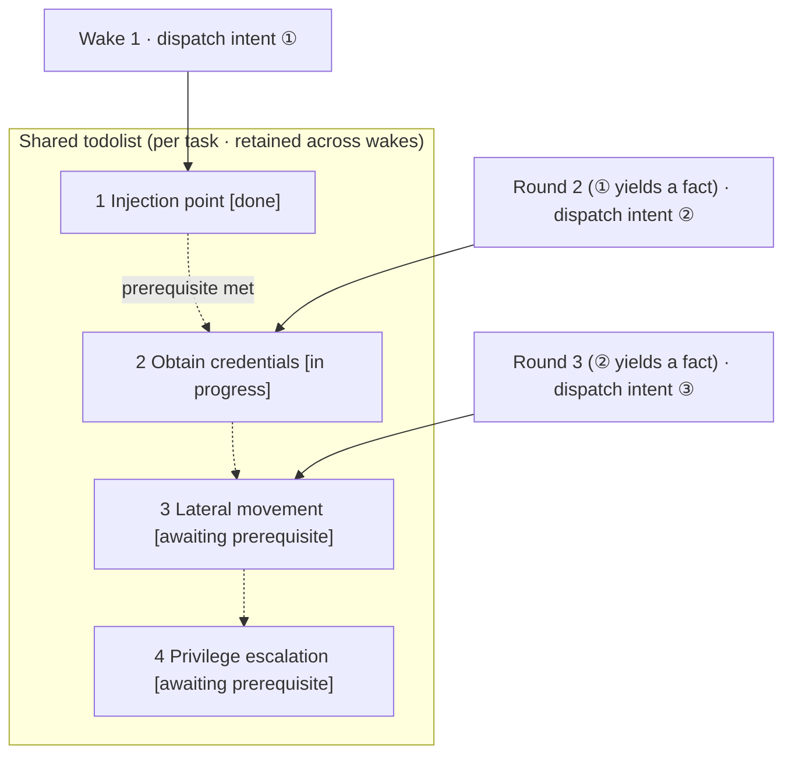

This keeps attack chains **progressing reliably, without repetition or reordering**, even with event-driven, stateless sessions. It is central to ARTEX's autonomous execution of multi-step exploit chains.

---

## Community

Search on WeChat for **SecSentry**, or scan the QR code to follow its official account. Send the account a direct message to join the discussion group.

<div align="center">


</div>

---
## References

https://github.com/oritera/Cairn


## License and Disclaimer

### Open Source License

This project is licensed under the **GNU Affero General Public License v3.0 (AGPL-3.0)**. See [LICENSE](LICENSE) in the repository root for the full terms.

Anyone may use, modify, and distribute this project, but **derivative works must also be open source under AGPL-3.0**. In particular, **if you modify the project and provide it to users over a network (such as an online service), you must also make the complete corresponding source code available to those users**.

> ⚠️ **Important**: The open source license itself does not restrict the software's purposes. The following usage restrictions and disclaimer are additional terms and statements from the author to users. Please comply with them.

**ARTEX is for personal learning, source code research, and local technical validation only. It must not be used for actual testing of any online system or website.**

### Permitted Uses

- Only **reading, learning from, and researching this project's source code**, and validating technical principles in a **local isolated environment**.
- Personal learning, academic research, code review, and other non-offensive uses.

### Prohibited Uses

- **Using this tool to scan, probe, exploit, or attack any website, online service, or network-connected system is strictly prohibited**, regardless of authorization or asset ownership.
- Actual penetration testing, attack-and-defense exercises, or use in production environments is strictly prohibited.
- Illegal intrusion, data theft, extortion, denial of service, or any destructive or criminal activity is strictly prohibited.
- Using this tool in violation of the laws and regulations of your country or region is strictly prohibited.

### Compliance Responsibility

Users must comply with all applicable cybersecurity, data protection, and computer crime laws and regulations in their country or region (in mainland China, including but not limited to the Cybersecurity Law, Data Security Law, Personal Information Protection Law, and related judicial interpretations). **Users bear all legal responsibility and consequences arising from use of this tool.**

### Disclaimer

This project is provided AS IS, without any express or implied warranties. The author and contributors accept no liability for direct or indirect losses, data loss, system damage, or legal disputes arising from use of this tool, whether used properly or otherwise. **By downloading, installing, or using this project, you acknowledge that you have read, understood, and agreed to all the terms above.**
