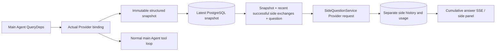

# ARTEX `/btw`

Normal chat, task MainAgent, and a task's own current Worker support independent side questions. Enter `/btw question` in the main input to submit one; an empty `/btw` or the Side question button opens history. Desktop uses a resizable sidebar; mobile uses a Drawer.

Answers use an Agent context snapshot captured at submission. Streaming, follow-up questions, stopping, and clearing are supported. Closing the panel, refreshing, or disconnecting SSE does not cancel the model request. Stop affects only the current side request. Clear cancels it and deletes side history while retaining the main context snapshot.

## Implementation boundaries

Uses Go, norma v0.3.7, Next.js, and existing Markdown / ResizablePanel / Drawer / AlertDialog components. No norma source changes or new side-question dependencies. Planner, Workers inherited from another task, and upgrades of tool-based subtasks are outside this scope.

- `capture.go` marks main-loop requests only at `Options.Deps.CallModel / CallModelSync`. The Provider decorator is inside the concrete model, after pool routing selects a member, so it captures the actual model. Compaction and summary calls do not overwrite snapshots.
- Publish snapshots at request start, complete model replies, and terminal run states. Exclude partially generated replies. norma's `MessagesForAPI` preserves tool pairing; results enter the next main model request or terminal snapshot. Interrupted streams retain the last valid boundary.
- JSON deep copies preserve structured messages, system prompts, tools, and generation parameters. Model inference holds neither the snapshot lock nor a database transaction.
- `SideQuestionService` calls the concrete Provider. It may summarize first; only the first context overflow before any text/tool output permits one reduced retry. It creates no agent session and has no tool executor, main transcript, activity stream, task graph, or task model-switch chain. Answer requests retain tool definitions for existing structured context; summary requests have none. Returned tool calls have no execution path.
- Allow one running request per parent session and four per service process, with a 120-second timeout. Side requests use independent cancellation under the service lifecycle.
- Preserve the model configuration reference and a nonsensitive identity digest; obtain credentials from current configuration. Deleted configurations or changed model/protocol/address identities require a new main Agent snapshot. Tests do not change the product's default model.

## Persistence and recovery

`db/schema.sql` creates `side_question_sessions` and `side_question_requests`. Sessions store the parent resource, latest snapshot, run ID, version, and clear generation. Requests store the question, cumulative answer, status, model, snapshot time, usage, event sequence, and pagination ordinal.

Parent keys use conversation ID or task ID + exploration ID + intent ID. Workers do not use reusable execution-slot names.

Coalesce snapshots per parent and flush every 250 ms. Compare `(run_id, version)` in the database to prevent stale overwrites. Save the chosen snapshot again before submission. Release large in-memory snapshots after successful persistence; keep pending versions on failure. Persist cumulative answers at most every 250 ms during streaming, then immediately at terminal states with bounded database retries.

At service startup, mark leftover `running` requests `interrupted`, retaining saved partial answers and usage without replaying requests. The latest saved context supports the next question. Old sessions without snapshots must run the main Agent first; do not reconstruct context from UI activity.

Clear increments the generation and deletes requests; conditional writes prevent late callbacks from restoring data. Foreign-key cascades handle physical parent deletion. Logical Worker deletion removes side data in the same transaction and rejects late snapshots. Task archival blocks new requests, waits for the main workflow, then cancels and drains side requests. Archive v3 remains compatible with v1/v2 without side tables.

Keep complete history, paginated newest-first by ordinal with at most 20 entries per page. Replay at most 20 successful exchanges within the token budget; maintain a rolling summary of older exchanges. If main context exceeds budget, summarize only its side copy's older portion, preserving recent structured tool calls/results. Preparation, summaries, and usage share side-request concurrency, cancellation, and the 120-second timeout. See [Context budgets and upstream references](CONTEXT_BUDGET.md).

## HTTP contract

These parent paths retain existing authentication and resource checks:

- `/api/conversations/{id}`
- `/api/tasks/{id}/chat`
- `/api/tasks/{id}/intents/{iid}`

| Request | Response and behavior |
| --- | --- |
| `GET {parent}/side-questions?before={ordinal}` | Newest-first `items`, separate `current` running state, `snapshot` metadata, and `next_cursor`; cursor 0 means latest page / no next page |
| `POST {parent}/side-questions` | JSON `{ "question": "…", "client_request_id": "UUID" }`; new requests return 202 and the request object; the same ID/question returns the existing object with 200 |
| `DELETE {parent}/side-questions` | Cancel and clear the parent's side questions |
| `GET /api/side-questions/{requestID}/events` | `snapshot` SSE events with increasing sequence `id` and the complete cumulative request object as `data`; clear emits `cleared` |
| `POST /api/side-questions/{requestID}/cancel` | Explicit cancellation; terminal state remains available through history/SSE |

Questions are limited to 4000 characters. Missing snapshots, changed model configuration, busy parents, and idempotency conflicts return 409; global concurrency overflow returns 429. Each SSE connection starts with cumulative state, independent of previously received fragments. The frontend merges by request ID + sequence and discards stale callbacks on parent switches or clear.

## Validation and references

See [VALIDATION.md](VALIDATION.md) for automated checks, real model use, and limitations.

Independent requests reference [Grok CLI side-question.ts (pinned commit)](https://github.com/superagent-ai/grok-cli/blob/fb97af83f06dca873281d60168430f06c8de6324/src/utils/side-question.ts); execution isolation references [OpenCode (pinned commit)](https://github.com/anomalyco/opencode/tree/b3f1a96c6dd7adeb28b36dd11add1998fc84d67b). ARTEX uses norma's structured messages rather than assembling text from frontend logs.
