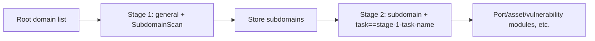

# ScopeSentry MCP Guide

For users with an **already deployed ScopeSentry instance**. Connect to the platform through Cursor (or another MCP client); no local source code is required.

## 1. Preparation

### 1.1 Check Service Access

- Default Web interface: `http://<host>`
- MCP endpoint: `http://<host>/mcp` (behind a reverse proxy or frontend proxy, use the actual `/mcp` address)

### 1.2 Create an API Key

1. Log in to the ScopeSentry Web interface in a browser
2. Open the **API Key** management page and create a key (or use an administrator-provided endpoint)
3. Save the returned `ssk_...` string (**shown only once**)

### 1.3 Configure Cursor MCP

Cursor → Settings → MCP → Add server:

```json
{
  "mcpServers": {
    "scopesentry": {
      "url": "http://<your-host>:8082/mcp",
      "headers": {
        "X-API-Key": "ssk_your-key"
      }
    }
  }
}
```

Alternatively, use: `Authorization: Bearer ssk_your-key`

After configuration, restart MCP or reload Cursor and confirm that tools such as `list_projects` and `list_assets` appear in the tool list.

---

## 2. Tool Overview


| Tool                     | Purpose                |
| ---------------------- | ----------------- |
| `list_projects`        | Project tree grouped by tag (includes project IDs) |
| `list_projects_data`   | Paginated project list with name search     |
| `get_project`          | Project details              |
| `create_project`       | Create a project              |
| `list_tasks`           | Scan task list            |
| `get_task`             | Task details              |
| `list_scan_templates`  | Scan template list            |
| `get_scan_template`    | Template details              |
| `list_plugin_modules`  | Scan pipeline module names          |
| `list_plugins`         | Available plugins (includes hashes and default parameters) |
| `create_scan_template` | Create a scan template            |
| `create_scan_task`     | Create a scan task            |
| `list_assets`          | Query asset types (paginated lists)       |
| `count_assets`         | Count assets (`/api/assets/common/total`) |
| `get_asset_detail`     | Asset or vulnerability details           |
| `add_asset_tag`        | Add a tag to assets           |
| `list_nodes`           | Scan node list            |


Use each MCP tool's description (schema) as the source of truth for its parameters. `list_assets` / `count_assets` share the same search and filter syntax; you can read the `list_assets` description first before querying assets.

For a total count, use `count_assets` (the Web pagination total endpoint); there is no need to page through `list_assets` repeatedly just to count records.

---

## 3. Common Workflows

### 3.1 Query Assets by Project

When the user or context **already specifies a project**, prefer `filter.project` to narrow the scope and avoid slow responses from excessive data across projects. A project filter is not required when no project is specified.

1. Use `list_projects` or `list_projects_data` to obtain the target project's **ObjectID** (`id` / `children[].value`)
2. Pass `filter.project` to `list_assets` (**must be an ID, not the project's display name**)

```json
{
  "asset_type": "asset",
  "pageIndex": 1,
  "pageSize": 20,
  "search": "domain=^example.com",
  "filter": {
    "project": ["<project-ObjectID>"]
  }
}
```

### 3.2 Create a Scan Task

1. Use `list_nodes` to obtain online node names
2. Use `list_scan_templates` or `create_scan_template` to obtain the template's **ObjectID**
3. Call `create_scan_task`: `name` and `node` are required; set `template` to the template ID (not its name)

**Target source `targetSource` (same as the Web interface):**

| targetSource | Description | Required parameters |
| --- | --- | --- |
| `general` | Enter targets directly | `target` |
| `project` | Read targets from projects | `project` (array of project ObjectIDs) |
| `asset` | Search the Web asset database | `search`; optional `project`, `filter`, `targetNumber` |
| `RootDomain` | Search the root domain database | `search`; optional `project`, `filter`, `targetNumber` |
| `subdomain` | Search the subdomain database | `search`; optional `project`, `filter`, `targetNumber` |
| `UrlScan` | Search URL scan results | `search`; optional `project`, `filter`, `targetNumber` |
| `*Source` (e.g. `subdomainSource`) | Create from selected assets or search results on an asset page | Use `search` when `targetTp=search`; use `targetIds` when `targetTp=select` |

**Example — scan root domains directly:**

```json
{
  "name": "example-subdomain-discovery",
  "node": ["node-1"],
  "template": "<template-ObjectID>",
  "targetSource": "general",
  "target": "example.com\nfoo.com",
  "project": ["<project-ObjectID>"]
}
```

**Example — continue scanning from the subdomain database (filter by the previous task name):**

```json
{
  "name": "example-ports-and-vulnerabilities",
  "node": ["node-1"],
  "template": "<subsequent-modules-template-ObjectID>",
  "targetSource": "subdomain",
  "search": "task==\"example-subdomain-discovery\"",
  "project": ["<project-ObjectID>"]
}
```

### 3.3 Complete Root Domain Reconnaissance (Two Stages Recommended)

When the input consists of **root domains** and **complete reconnaissance** is needed, two scans are recommended; avoid running the entire pipeline in a single scan.

**Reason:** Distributed tasks are dispatched **one target at a time**. When a root domain is assigned to a node, subdomains discovered on that node also run subsequent modules on the same node. This can cause uneven load, slower scans, and errors.

**Best practice:**

1. **Stage 1 — subdomain discovery only**
   - `targetSource`: `general`
   - `target`: all root domains (one per line)
   - Template: enable only `SubdomainScan` and `SubdomainSecurity` (subdomain scanning + subdomain takeover)
   - Use `get_task` to wait for task completion

2. **Stage 2 — subsequent modules**
   - `targetSource`: `subdomain`
   - `search`: `task=="<stage-1-task-name>"` (exact task-name match)
   - Optionally use `project` to narrow the scope
   - Template: port scanning, asset mapping, vulnerability scanning, etc. (may omit SubdomainScan)
   - Subdomains are dispatched to nodes as independent targets for more efficient parallel execution

The equivalent Web workflow is to filter by task name on the Subdomain asset page, then choose Create task from subdomains.



### 3.4 Create a Scan Template

1. `list_plugin_modules` → list of module names
2. `list_plugins` (optionally filter by `module`) → each plugin's `hash` and default `parameter`
3. `create_scan_template`: use `modules` to specify a mapping from module names to arrays of plugin hashes

---

## 4. Asset Queries (`list_assets` / `count_assets`)

`count_assets` and `list_assets` use the same `asset_type`, `search`, and `filter`; the count response is `{ "total": N }`, corresponding to the Web endpoint `/api/assets/common/total`.

```json
{
  "asset_type": "subdomain",
  "search": "task==\"some-task-name\"",
  "filter": {"project": ["<project-ObjectID>"]}
}
```

**Performance guidance (for both `list_assets` / `count_assets`):** When a project is specified, prefer `filter.project` to narrow the scope. For indexed fields in `search`, prefer `==` equality or `^` prefix matching (see [4.3](#43-search-expressions)) to avoid slow responses from broad `=` fuzzy queries. A project filter is not required when there is no project context.

See the table in [4.4](#44-exact-filters) for types that support `filter.project`.

### 4.1 Asset Types `asset_type`

`asset`, `RootDomain`, `subdomain`, `app`, `mp`, `UrlScan`, `SensitiveResult`, `DirScanResult`, `crawler`, `vulnerability`, `PageMonitoring`, `IPAsset`, `SubdomainTakerResult`

Alias examples: `web`→asset, `vuln`→vulnerability, `ip`→IPAsset, `url`→UrlScan

### 4.2 Parameters


| Parameter                       | Description                                      |
| ------------------------ | --------------------------------------- |
| `pageIndex` / `pageSize` | Pagination; defaults to 1 / 20                            |
| `search`                 | Search expression (see below)                              |
| `filter`                 | Exact-filter JSON (see below)                          |
| `sort`                   | Only UrlScan and DirScanResult support sorting by `length` |
| `sid`                    | SensitiveResult only: sensitive rule name                |


`search` and `filter` **can be combined**.

### 4.3 search Expressions

Custom DSL (**not SQL**):


| Operator  | Meaning   | Index use | Example                          |
| ---- | ---- | ---- | --------------------------- |
| `=`  | Fuzzy match (regex) | Does not use an index | `domain=example`            |
| `==` | Exact match (equality) | **Uses an index** | `port==443`                 |
| `!=` | Exclude   | — | `port!="80"`                |
| `&&` | AND    | — | `domain==example.com && port==443` |
| `||` | OR    | — | `title=admin || body=login` |


**Indexes and operators:** Fields such as `domain`, `ip`, `port`, and `title` are indexed, but only **`==` equality** or **prefix matching with a value beginning with `^`** (such as `domain=^example.com`) can use an index. **`=` becomes a regex fuzzy match and cannot use an index**, which can be slow on large datasets.

**Search fields shared by all types:** `tag`, `task` (task name), `rootDomain`

**Do not put project in search** (it is invalid or causes an error when combined with `&&`). Use `filter.project` to filter by project.

**Common search fields by type:**


| asset_type           | Fields                                                                                  |
| -------------------- | ----------------------------------------------------------------------------------- |
| asset                | domain, ip, port, service, app, title, statuscode, icon, banner, type, body, header |
| RootDomain           | domain, icp, company                                                                |
| subdomain            | domain, ip, type, value                                                             |
| app                  | name, icp, company, category, description, url, apk                                 |
| mp                   | name, icp, company, category, description, url                                      |
| UrlScan              | url, input, source, resultId, type                                                  |
| SensitiveResult      | url, sname, body, info, md5                                                         |
| DirScanResult        | url, statuscode, redirect, length                                                   |
| vulnerability        | url, vulname, matched, request, response, level                                     |
| crawler              | url, method, body, resultId                                                         |
| PageMonitoring       | url, hash, diff, response                                                           |
| IPAsset              | ip, domain, port, service, webServer, app                                           |
| SubdomainTakerResult | domain, value, type, response                                                       |


**search examples:**

- `domain==www.example.com && port==443` (equality, uses an index)
- `domain=^example.com` (prefix match, uses an index)
- `ip==192.168.1.1`
- `task=="some-task-name"`
- `level==high` (vulnerability)
- `statuscode==200` (DirScanResult)

Use `=` only when a fuzzy contains match is needed, such as `title=admin` (does not use an index; combine it with project or other conditions to narrow the scope).

### 4.4 Exact Filters

JSON object: multiple values for the same key use **OR**; different keys use **AND**.

**Prefer `project` when a project is specified:** If the user or context specifies a project and the asset_type supports `project`, include it to narrow the scope. It is not required when no project information is available.


| filter key   | Meaning       | Values                                                     |
| ------------ | -------- | -------------------------------------------------------- |
| `project`    | Owning project     | **ObjectID**, obtained with `list_projects` / `list_projects_data` |
| `task`       | Source task     | **Task name**, from `list_tasks`'s `name`                         |
| `port`       | Port       | e.g. `"443"`                                                |
| `service`    | Service/protocol    | e.g. `"https"`                                              |
| `app`        | Application fingerprint     | e.g. `"Nginx"`                                              |
| `icon`       | Icon hash  |                                                          |
| `statuscode` | HTTP status code | Primarily for asset                                               |
| `status`     | Status       | UrlScan/DirScan HTTP code; vulnerability/sensitive-information handling status                       |
| `level`      | Vulnerability severity     | critical / high / medium / low / info                    |
| `type`       | Type       | e.g. subdomain record types A, CNAME                                         |
| `color`      | Sensitive rule color   | SensitiveResult                                          |
| `sname`      | Sensitive rule name    | SensitiveResult                                          |
| `tags`       | Tags       |                                                          |


**Available filter keys by type:**


| asset_type                            | filter key                                                      |
| ------------------------------------- | --------------------------------------------------------------- |
| asset                                 | project, port, service, app, icon, statuscode, type, task, tags |
| RootDomain                            | project, tags                                                   |
| subdomain                             | project, type, task, tags                                       |
| app / mp                              | project, tags                                                   |
| UrlScan                               | status, tags                                                    |
| DirScanResult                         | status, tags                                                    |
| SensitiveResult                       | status, color, sname, tags                                      |
| crawler                               | project, task, tags                                             |
| vulnerability                         | project, level, status, task, tags                              |
| PageMonitoring / SubdomainTakerResult | tags                                                            |
| IPAsset                               | project, port, service, app                                     |


**filter example:**

```json
{"project": ["<project-ObjectID>"], "port": ["443"]}
```

**Combined query example:**

```json
{
  "asset_type": "asset",
  "search": "domain=^baidu && port==443",
  "filter": {"project": ["<project-ObjectID>"]},
  "pageIndex": 1,
  "pageSize": 10
}
```

**Notes:**

- Prefer `filter.project` when a project is specified (if supported); it is not required without project context
- Do not put project display names in `filter.project`
- Use `==` for known values and `^` for prefixes; avoid excessive `=` fuzzy matching on large tables
- For UrlScan HTTP status, use `filter.status`; DirScanResult can use `statuscode==200` in search
- For SensitiveResult rule names, use `sname=rule-name` in `search`, or use `filter.sname`

### 4.5 Sorting with sort

Supported only by **UrlScan** and **DirScanResult**:

```json
{"length": "ascending"}
```

Other types ignore `sort` and use the default time ordering.

---

## 5. Scan Template Module Names

`TargetHandler`, `SubdomainScan`, `SubdomainSecurity`, `PortScanPreparation`, `PortScan`, `PortFingerprint`, `AssetMapping`, `AssetHandle`, `URLScan`, `WebCrawler`, `URLSecurity`, `DirScan`, `VulnerabilityScan`, `PassiveScan`

---

## 6. Troubleshooting


| Symptom        | Action                                                 |
| --------- | -------------------------------------------------- |
| No MCP tools   | Check the URL, API Key, and whether ScopeSentry is running                    |
| 401 / 403 | Recreate or replace the API Key                                    |
| Assets not found     | Confirm `filter.project` is an ObjectID; do not put project in search |
| Template/task creation fails | `template` must be a template ObjectID; set `node` to online node names            |
| Queries are slow or stuck   | Add `filter.project` when a project is specified; use `==` or a `^` prefix for indexed search fields, use `=` sparingly, and reduce `pageSize` |


---

